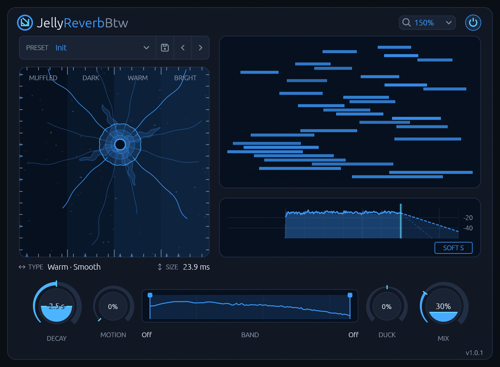

# JellyReverbBtw

**A reverb whose room you pick with a jellyfish: 256 rooms on one pad, four kinds of walls and four shapes across,
sixteen sizes up.** CLAP for Linux.



**[JellyReverbBtw on jelly-comet.github.io](https://jelly-comet.github.io/plugins/jellyreverbbtw/)**: more screenshots, the manual to read or as a PDF, and every release.

JellyReverbBtw holds 256 rooms on one jellyfish pad. Across, the walls go from muffled to dark, warm and bright, and
in each of those four zones the room takes four shapes: Smooth, Echo, 2 Rooms and 4 Rooms. Up, the same room gets
larger. Drag the jellyfish and you walk from room to room: the new room fills while the ones you left ring out, with
no gap and no click. BAND keeps the reverb to part of the spectrum, so a kick's low end stays dry; DUCK pushes the
room down while the input plays, and turned the other way it is a GATE, for gated drums. SOFT S keeps a singer's s's
from splashing in the room, and MOTION keeps a long tail from ringing metallic. It has no latency. It is not a
convolution reverb and not a delay: every room is an algorithmic one, and you choose it by place, not by numbers.

**[Read the manual](manual.md)** for every control and how to use it.

## What it's for

- **Drum rooms and gated reverb:** a short dark room behind a snare, or GATE for the classic gated drum sound.
- **Vocal reverb:** a bright space ducked under a voice, its low end dry and its s's softened.
- **Halls and big ambient spaces:** DECAY up to 20 s, MOTION against the metallic ring of a long tail.
- **Finding a room by ear:** drag across the pad while the track plays, from muffled to bright, small to large.

## Features

- **256 rooms on one pad:** 16 TYPEs across, in four zones of walls from muffled to bright, and 16 SIZEs up, from 6 to
  60 ms. At DECAY 2.5 s every room's reverb time lands within 1.17 % of DECAY on average.
- **A room switch that follows the jellyfish:** up to eight rooms ring at once, so the rooms you left ring out under
  the new one. Dragged across the pad, the level stays within 1.5 dB and nothing clicks.
- **BAND:** outside it the input passes untouched at any MIX, so the low end or the top can stay dry.
- **DECAY from 0.2 to 20 s,** or typed as `1 bar`, `2 beats` or `1/4` at the song's tempo.
- **DUCK and GATE:** right of its middle DUCK pushes the room down while the input plays; left of it, the room shuts
  150 ms after the input stops, for gated drums.
- **SOFT S:** de-esses the room's input and leaves the dry alone: on s's between vowels the room's 4 to 10 kHz came
  down 3.6 dB.
- **MOTION:** a quarter of the room's lines wander a little, so a long tail rings less metallic.
- **A window that shows the room:** its 32 lines, the tail over the last seconds and where it is going, on the song's
  beats and bars, and the reverb's spectrum in the band.
- **No latency.**
- **Light:** 0.38 % of a CPU core at the defaults, stereo at 48 kHz, about 3.4 % while the jellyfish is flung across
  the pad at DECAY 20 s, and next to nothing on silence.
- **Stereo, and mono in to stereo out.**
- **Presets:** six built-in rooms beside Init, and your own.
- **Zoom** from 100 to 200 %.
- **No network access and no telemetry.**

## Install

Download the latest version from the [Releases page](https://github.com/jelly-comet/JellyReverbBtw-release/releases),
or with these commands:

```bash
curl -LO https://github.com/jelly-comet/JellyReverbBtw-release/releases/download/v1.0.1/JellyReverbBtw-1.0.1-linux-x86_64.tar.gz
curl -LO https://github.com/jelly-comet/JellyReverbBtw-release/releases/download/v1.0.1/JellyReverbBtw-1.0.1-linux-x86_64.tar.gz.sha256
sha256sum -c JellyReverbBtw-1.0.1-linux-x86_64.tar.gz.sha256 && tar xzf JellyReverbBtw-1.0.1-linux-x86_64.tar.gz
cd JellyReverbBtw-1.0.1-linux-x86_64
```

Install for your user:

```bash
mkdir -p ~/.clap
rm -f ~/.clap/JellyReverbBtw.clap && cp JellyReverbBtw.clap ~/.clap/
```

Or for all users:

```bash
sudo mkdir -p /usr/lib/clap
sudo rm -f /usr/lib/clap/JellyReverbBtw.clap && sudo cp JellyReverbBtw.clap /usr/lib/clap/
```

Removing the old copy first avoids overwriting a file a running host has loaded. Then rescan plugins
in your DAW.

To uninstall:

```bash
rm -f ~/.clap/JellyReverbBtw.clap
```

Your presets stay in `~/.local/share/JellyReverbBtw/presets/`; delete that folder too if you want them gone.

## Requirements

- Linux x86-64 on a CPU with AVX2 (Intel Core from 2013, AMD from 2015), with glibc 2.31 or newer (Ubuntu 20.04, Debian 11, Fedora 32 and newer)
- A CLAP host. Tried in REAPER.
- X11 or XWayland, and a Vulkan driver for the editor

Releases contain the CLAP plugin only.

## FAQ

### Is it free?

Yes. The download is free and MIT-licensed.

### Is there a VST3 or LV2 version?

No. Releases contain the CLAP plugin only.

### Does it run on ARM, like a Raspberry Pi or Apple Silicon?

No. It needs Linux on x86-64, on a CPU with AVX2.

### Which hosts does it work in?

Any CLAP host. It was tried in REAPER.

### Does it work on Wayland?

Through XWayland. The editor also needs a Vulkan driver.

### Can I load impulse responses into it?

No. It is an algorithmic reverb, not a convolution one: its 256 rooms are built in, and you pick one with the
jellyfish.

## License

MIT, see [LICENSE](LICENSE). The licenses of the third-party code in the binaries are in
`THIRD-PARTY-LICENSES.txt` in each release archive.

VST is a registered trademark of Steinberg Media Technologies GmbH. CLAP is an open standard by the
free-audio project. JellyReverbBtw is an independent project, not affiliated with or endorsed by the
makers of any other reverb.
