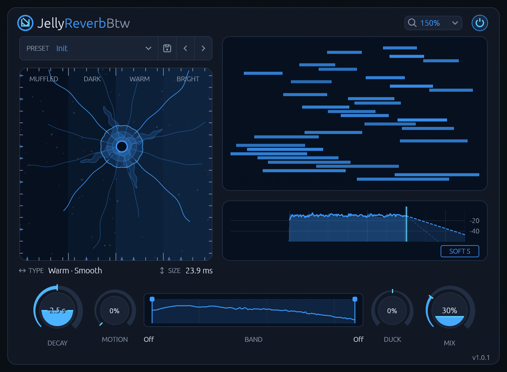
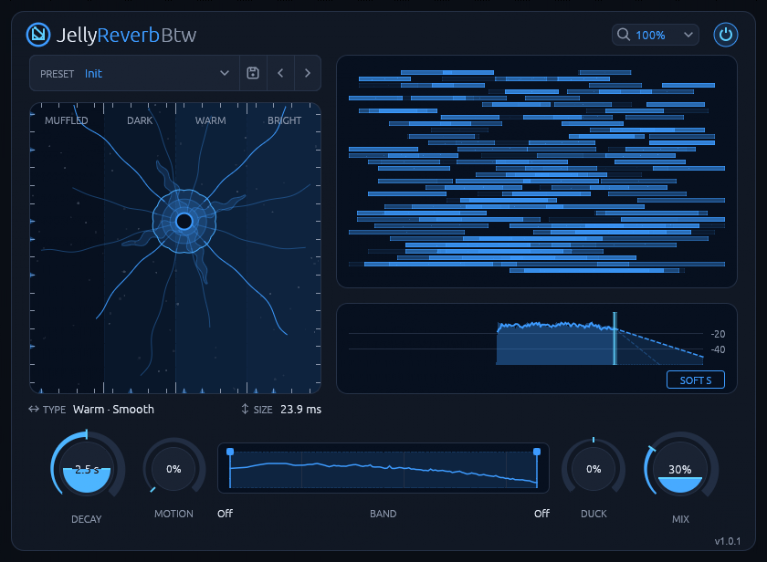
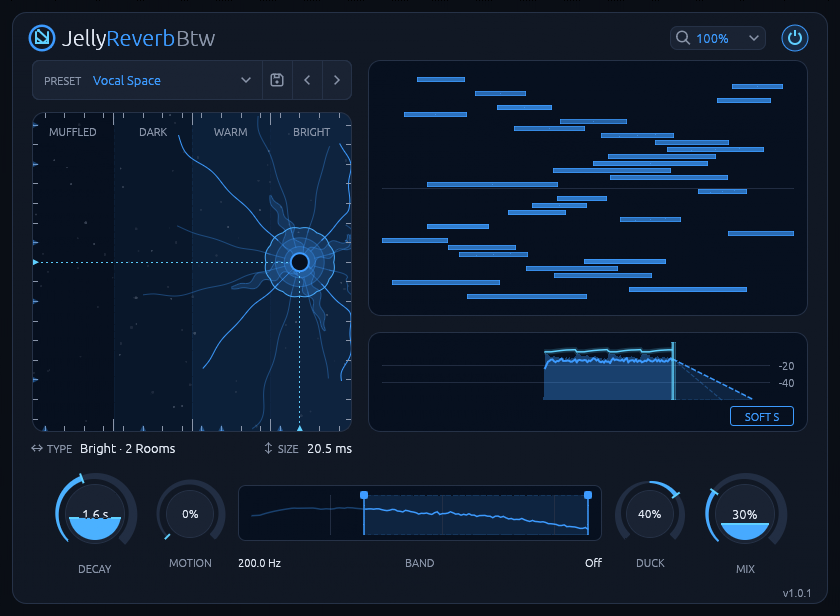
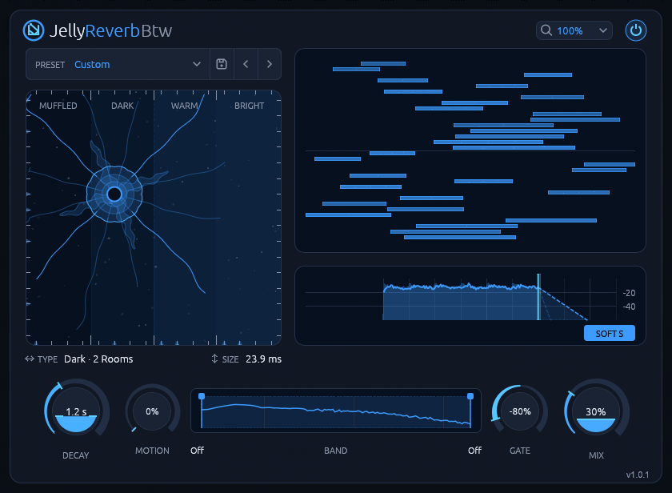

# JellyReverbBtw manual

**A reverb whose room you pick with a jellyfish: 256 rooms on one pad, four kinds of walls and four shapes across,
sixteen sizes up.**

Version 1.0.1. To install it, see the [install steps](README.md#install).

## Contents

- [Getting started](#getting-started)
- [The controls](#the-controls)
- [How to use it](#how-to-use-it)
- [Good to know](#good-to-know)
- [Troubleshooting](#troubleshooting)

## Getting started

Put JellyReverbBtw on a send, or straight on a vocal, a drum bus or a synth, and play. At the defaults the jellyfish
sits on Warm · Smooth at 23.9 ms with DECAY 2.5 s and MIX 30 %. Drag the jellyfish while the track plays: left for
duller walls, right for brighter ones, down for a smaller room, up for a larger one. When you like the room, set DECAY
for how long it rings and MIX for how much of it you hear. On a send, set MIX to 100 %.

Or pick a room from the PRESET list, Drum Room or Vocal Space, and start from there.

## The controls

From the top left of the window.

| Control | Range | Default | What it does |
| --- | --- | --- | --- |
| **PRESET** | a list | Init | See [Presets](#presets). |
| **Zoom** | 100 to 200 % | 100 % | The window's size, kept with the project. |
| **Power switch** (top right) | on, off | on | Off, the input passes untouched, crossfaded over 20 ms, and the room stands still; on starts the tail from silence. |
| **The pad: TYPE** (across) | 16 types, Muffled · Smooth to Bright · Smooth | Warm · Smooth | Four zones of walls (Muffled, Dark, Warm, Bright), each with four shapes (Smooth, Echo, 2 Rooms, 4 Rooms). |
| **The pad: SIZE** (up) | 6.0 to 60 ms, 16 steps | 23.9 ms | The same room smaller or larger. The scroll wheel over the pad steps it. |
| **The room's lines** (top right) | | | The room's 32 delay lines as bars, brighter while they ring. |
| **The tail** (below them) | | | The reverb's level over the last seconds and where it is going, on the song's beats. |
| **SOFT S** (on the tail's strip) | on, off | off | De-esses the room's input, so s's splash less in the room; the dry is left alone. |
| **DECAY** | 0.2 to 20 s | 2.5 s | How long the room rings: the time its tail takes to fall 60 dB at 500 Hz. |
| **MOTION** | 0 to 100 % | 0 % | Lets the room's lines wander a little, so a long tail rings less metallic. |
| **BAND** | Off (20 Hz) to Off (20 kHz) | Off, Off | Where the reverb plays: outside it the input passes untouched. The strip shows the reverb's spectrum. |
| **DUCK** | −100 to 100 % | 0 % | Right of its middle, pushes the room down while the input plays. Left of it, its caption reads GATE: the room shuts once the input stops. |
| **MIX** | 0 to 100 % | 30 % | How much of the room you hear inside the band. 0 % is the dry input. |

**Mouse:** drag the jellyfish, or press anywhere on the pad to move it there. Drag a knob or a band edge up or down;
hold Shift for fine steps; turn the scroll wheel over it; double-click to reset to the default; right-click a knob to
type a value (`2 s`, `30%`). Every control shows a one-line tooltip. The host can automate every parameter.

## How to use it

### Picking a room on the pad

The pad's columns of light are its four zones of walls: Muffled at the left, then Dark, Warm and Bright. The brighter
the walls, the more of the tail's top end they keep: in the muffled rooms about a sixth of it is left at 5 kHz, in the
bright ones about three fifths. Inside each zone the room takes four shapes:

- **Smooth:** a dense, even tail.
- **Echo:** the echoes build up slowly and are heard apart.
- **2 Rooms** and **4 Rooms:** coupled spaces, close to Smooth in how fast they build up.

The shapes are turned round in every other zone, so the jellyfish's neighbours differ in one thing only. Up the pad
the same room grows: its first reflection comes later at every step, from 2.3 to 30.3 ms, and its echoes grow denser.

Every preset is two notches on the pad's rulers, its TYPE below and its SIZE at the left. Hover one for its name and a
crosshair to its room; click it to move the jellyfish there (TYPE and SIZE only, the rest stays).

### Walking from room to room

Drag the jellyfish while the track plays and the room follows: the new room fills while the ones you left ring out,
up to eight at once, so there is no gap and no click. The room follows at most every 100 ms, so a fast drag plays a
few of the rooms it crosses, and the room under the jellyfish plays within 100 ms of where it stops. This makes the
pad playable: automate TYPE and SIZE and the space itself moves through a song.

### DECAY, MIX and MOTION

DECAY is how long the room rings, from a short 0.2 s knock to a 20 s wash, measured at 500 Hz; the walls set how much
faster the top end dies. Type `1 bar`, `2 beats` or `1/4` into DECAY to set it at the song's tempo. The tail display
then marks the song's beats and bars while the host plays, and its forecast shows where the tail will be at the next
beats; a fainter dashed line shows how the top end (5 kHz) falls.

MIX is equal-power: the room comes up as the dry goes down, without a dip in the middle. On a send, set it to 100 %.

A long DECAY can ring metallic in a small room. MOTION lets a quarter of the room's lines wander a little, which
smooths that ring; at 0 % the room stands still.

### BAND: keep the low end dry

BAND picks where in the spectrum the reverb plays. Outside it the input passes as it is, whatever MIX says. Drag the
low edge up to 150 or 200 Hz and a kick or a bass stays dry and tight while the rest gets the room; drag the high edge
down for a darker reverb. Drag the middle to move the whole band. With both edges off, nothing is filtered.

### DUCK and GATE

Turned right, DUCK pushes the room down while the input plays (within 5 ms) and lets it back up over 250 ms, so a
vocal stays clear and the reverb blooms in the gaps. Vocal Space starts at 40 %.

Turned left, its caption reads GATE: the room stays open while the input plays, holds 150 ms after it stops, then shuts
in 40 ms. At 100 % that is the gated drum sound: a big room cut off after every hit. At 50 % the room drops 6 dB in the
gaps instead of shutting.

### SOFT S

A singer's s's and t's splash loudly in a bright room. SOFT S de-esses only what goes into the room and leaves the dry
voice alone: on a test of s's between vowels, the room's 4 to 10 kHz came down 3.6 dB and its vowels didn't move. It
sits on the strip under the tail display. Presets leave it as it is.

### Presets

The PRESET list holds Init (every default), your favourites, the six built-in rooms and then your own. The arrows step
through them, the disk saves the current settings under a name, and PRESET reads `Custom` once a setting differs from
every preset. A preset is the room: TYPE, SIZE, DECAY, MOTION, DUCK and the band. It leaves MIX, SOFT S and the power
switch alone, so it changes the room and not how much of it a track gets.

| Preset | Room | For |
| --- | --- | --- |
| Small Box | Muffled · Smooth, 8.2 ms, 0.5 s | A short dull knock behind a snare. |
| Drum Room | Dark · 2 Rooms, 15.1 ms, 0.9 s | Dense and fast, dark enough not to splash. |
| Echo Chamber | Warm · Echo, 23.9 ms, 1.8 s | The echoes heard apart. |
| Warm Hall | Warm · Smooth, 44.1 ms, 3.5 s, MOTION 30 % | A warm hall without the metallic ring. |
| Vocal Space | Bright · 2 Rooms, 20.5 ms, 1.6 s, DUCK 40 %, from 200 Hz | Bright and ducked under a voice, the low end dry. |
| Stone Rooms | Bright · 4 Rooms, 60 ms, 6 s, MOTION 20 % | A big room of bright coupled spaces. |

Your presets are text files in `~/.local/share/JellyReverbBtw/presets/`, shared by every project.

## Good to know

- **No latency:** nothing for the host to compensate.
- **The tail is reported:** the host keeps calling the plugin for 3 × DECAY after the input stops, so a tail at the end
  of a song is rendered, and stops once it has rung out.
- **Mono or stereo:** a mono input gives a stereo room.
- **Light:** 0.38 % of a CPU core at the defaults, stereo at 48 kHz, 0.75 % with SOFT S. Flinging the jellyfish across
  the pad at DECAY 20 s keeps eight rooms ringing, about 3.4 %. On silence, once the rooms have rung out, next to
  nothing.
- **Click-free changes:** MIX, DUCK and the power switch glide over 20 ms, DECAY over 50 ms, so you can automate them.
- **The power switch** lets the room stand still: switching on again starts the tail from silence.
- **The built-in rooms are drafts,** set from measurements of the map, not yet voiced by ear.

## Troubleshooting

- **The plugin doesn't show up:** check that the bundle is in `~/.clap` or `/usr/lib/clap`, then rescan plugins in
  your DAW. It needs a CPU with AVX2.
- **The editor window stays black or doesn't open:** check that a Vulkan driver is installed. The `vulkaninfo` tool
  from `vulkan-tools` should list your GPU.
- **The low end gets muddy:** drag BAND's low edge up, to 150 or 200 Hz.
- **A fast drag skips rooms:** the room follows the jellyfish at most every 100 ms, so the level holds while it moves.
  Let it rest and the room under it plays within 100 ms.
- **The CPU climbs while the jellyfish moves at a long DECAY:** up to eight rooms ring at once. It falls back as they
  ring out.
- **The tail is gone after the power switch:** off lets the room stand still, and on starts it from silence.
- **A preset doesn't change MIX:** presets hold the room, not how much of it a track gets.
- **Typing a preset's name does nothing:** some hosts keep keystrokes for themselves. Write the preset file by hand:
  one `id value` line a parameter, such as `type 9`, `size 10` or `decay 2.5`.
- **A preset doesn't show up in the menu:** its file must end in `.preset`, and its name can't be Init's or a built-in
  room's. The editor reads the folder when it opens and after a save, so reopen it after adding files by hand.
